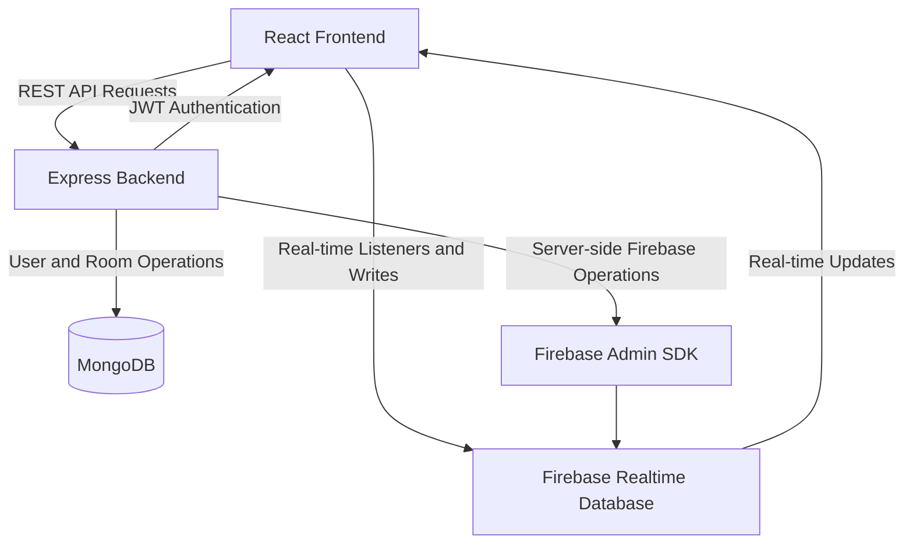

# XChat — Real-Time Full-Stack Chat Application

A full-stack, one-to-one messaging application built using the **MERN stack, Firebase Realtime Database, and JWT-based authentication**.

XChat enables users to register, authenticate, discover other users, initiate private conversations, and exchange messages in real time. It also supports online/offline presence and typing indicators, providing a responsive messaging experience without requiring users to refresh the application.

**Live Demo:** https://x-chat-tau.vercel.app/

---

## Table of Contents

1. [Overview](#overview)
2. [Key Features](#key-features)
3. [Technology Stack](#technology-stack)
4. [System Architecture](#system-architecture)
5. [Architectural Decisions](#architectural-decisions)
6. [Authentication and Authorization](#authentication-and-authorization)
7. [Real-Time Messaging](#real-time-messaging)
8. [Online Presence](#online-presence)
9. [Typing Indicators](#typing-indicators)
10. [Database Design](#database-design)
11. [Application Workflow](#application-workflow)
12. [Project Structure](#project-structure)
13. [API Endpoints](#api-endpoints)
14. [Environment Configuration](#environment-configuration)
15. [Installation and Setup](#installation-and-setup)
16. [Future Improvements](#future-improvements)

---

## Overview

XChat is a real-time, one-to-one messaging application designed around a hybrid backend architecture.

The application uses **MongoDB as its primary database** for persistent application data, including user accounts and conversation metadata, while **Firebase Realtime Database handles live communication**, including messages, typing indicators, and online presence.

The Express backend is responsible for authentication, user management, conversation initialization, and protected API operations. The React frontend communicates with the backend through REST APIs and connects to Firebase for real-time updates.

This separation allows each technology to handle the responsibilities it is best suited for:

- MongoDB manages structured, persistent application data.
- Express and Node.js handle business logic and API operations.
- Firebase Realtime Database provides event-driven, real-time data synchronization.
- React manages the user interface and application state.

The goal was not simply to build a messaging interface, but to understand how different backend services can work together to build a responsive, scalable application.

---

## Key Features

### Authentication and User Management

- User registration with input validation.
- Secure password hashing using bcrypt.
- JWT-based authentication.
- HTTP-only authentication cookies.
- Protected backend routes.
- Persistent login sessions.
- Logout functionality.
- Duplicate account prevention.

### User Discovery

- Search for registered users.
- Initiate conversations with other users.
- Display user information in the conversation sidebar.
- Retrieve existing conversations.

### Real-Time Messaging

- One-to-one messaging.
- Instant message synchronization using Firebase Realtime Database.
- Real-time message updates without polling or page refreshes.
- Message persistence in Firebase.
- Conversation-specific message organization.
- Message history retrieval when opening a conversation.

### Online Presence

- Real-time online/offline status.
- Presence updates synchronized across connected clients.
- Firebase connection-state monitoring.

### Typing Indicators

- Real-time typing status.
- Dynamic typing indicator updates.
- Automatic removal of typing status when a user stops typing or disconnects.

### User Interface

- Responsive chat interface.
- Conversation sidebar.
- Search interface.
- Individual conversation view.
- Login and registration screens.
- Toast notifications for user feedback.

---

## Technology Stack

| Technology                  | Purpose                                    |
| --------------------------- | ------------------------------------------ |
| React                       | Component-based frontend development       |
| React Router                | Client-side navigation                     |
| Tailwind CSS                | Utility-first styling                      |
| React Hook Form             | Form state management                      |
| Zod                         | Schema-based input validation              |
| Axios                       | HTTP communication with the backend        |
| React Hot Toast             | User feedback and notifications            |
| Node.js                     | JavaScript runtime for the backend         |
| Express.js                  | REST API and backend application framework |
| MongoDB                     | Persistent application data storage        |
| Mongoose                    | MongoDB object modeling                    |
| Firebase Realtime Database  | Real-time messaging and presence           |
| Firebase Admin SDK          | Server-side Firebase operations            |
| Firebase Authentication SDK | Client-side Firebase authentication        |
| bcryptjs                    | Password hashing                           |
| JSON Web Tokens             | Authentication and authorization           |
| Cookie Parser               | Reading authentication cookies             |
| CORS                        | Cross-origin request configuration         |
| Vite                        | Frontend development and build tooling     |

---

## System Architecture

XChat follows a hybrid architecture in which the Express backend and Firebase Realtime Database work together.



### Responsibilities of Each Layer

**1. React Frontend**

The frontend handles:

- User interaction and navigation.
- Authentication forms.
- User discovery.
- Conversation selection.
- Sending and displaying messages.
- Subscribing to real-time Firebase updates.
- Displaying presence and typing indicators.

**2. Express Backend**

The backend handles:

- User registration and login.
- Password verification.
- JWT generation and validation.
- Protected API routes.
- User search.
- Conversation initialization.
- Retrieving a user's conversations.
- Server-side Firebase operations.

**3. MongoDB**

MongoDB stores persistent application-level information:

- User accounts.
- Hashed passwords.
- User profile information.
- Conversation and participant metadata.

**4. Firebase Realtime Database**

Firebase handles frequently changing real-time information:

- Messages.
- Online/offline status.
- Typing indicators.

This division keeps the responsibilities of the primary database separate from the real-time communication layer.

---

## Architectural Decisions

### 1. Why MongoDB and Firebase Together?

One of the most important architectural decisions was separating persistent application data from real-time communication.

MongoDB is well suited for managing user records, relationships, and conversation metadata. However, implementing real-time communication directly through a traditional REST API requires additional infrastructure.

For example, a conventional Express API does not automatically notify another client when a new message is inserted into MongoDB.

The receiving client would need to periodically request updates, or the application would need an additional real-time communication mechanism.

Firebase Realtime Database provides built-in synchronization between connected clients.

Therefore, XChat uses:

- MongoDB for persistent application data.
- Firebase for real-time communication.

This avoids introducing a separate WebSocket server while still providing real-time functionality.

### 2. Why Firebase Realtime Database Instead of Socket.IO?

Socket.IO is a powerful option for implementing real-time communication using WebSockets and fallback transports.

However, it requires maintaining a persistent connection infrastructure on the backend, managing socket events, rooms, connection lifecycle, and message broadcasting.

Firebase Realtime Database provides:

- Real-time listeners.
- Automatic synchronization between clients.
- Built-in connection-state information.
- A managed infrastructure for live data updates.

For this application's requirements, Firebase offered a simpler way to implement real-time functionality without maintaining a separate socket server.

This was a deliberate architectural trade-off rather than an assumption that Firebase is universally better than WebSockets.

### 3. Why Use REST APIs for Conversation Management?

Although Firebase handles real-time messaging, the Express backend remains responsible for conversation management.

For example, when a user selects another user to initiate a conversation, the frontend communicates with the backend to initialize or retrieve the conversation.

The backend can then validate the participants and manage the conversation metadata in MongoDB.

This ensures that conversation creation and user relationships are controlled by the backend rather than being treated as arbitrary client-side data.

### 4. Why JWT Authentication?

JWT-based authentication provides a stateless way for the backend to verify authenticated requests.

After successful login:

- The backend generates a signed JWT.
- The token is delivered through an HTTP-only cookie.
- Protected routes verify the token before processing requests.

This avoids storing authentication tokens in browser-accessible local storage and reduces exposure to token theft through JavaScript-based attacks.

### 5. Why Firebase Authentication Alongside JWT?

The application uses two authentication contexts for different responsibilities:

- JWT authenticates users with the Express backend.
- Firebase Authentication establishes an authenticated Firebase client session.

The backend uses the Firebase Admin SDK for privileged server-side Firebase operations, while the frontend uses the Firebase client SDK to interact with the Realtime Database.

This allows the application to maintain backend authentication while also controlling access to Firebase resources.

---

## Authentication and Authorization

XChat uses a two-layer authentication architecture.

### Backend Authentication

The authentication flow is:

1. The user submits their login credentials.
2. Express retrieves the corresponding user from MongoDB.
3. bcrypt verifies the submitted password against the stored password hash.
4. The backend generates a signed JWT.
5. The token is sent through an HTTP-only cookie.
6. Subsequent protected requests include the cookie.
7. Authentication middleware verifies the JWT and identifies the authenticated user.

Passwords are never stored in plaintext.

### Frontend Authentication State

The React application maintains authentication state through a centralized authentication context.

When the application initializes, it checks the current authentication status by requesting the authenticated user's information from the backend.

This allows the application to:

- Maintain the authenticated user across page refreshes.
- Display appropriate screens based on authentication state.
- Protect authenticated application routes.
- Handle logout and session expiration.

### Firebase Authentication

The backend also uses Firebase Admin SDK capabilities to support authenticated Firebase access.

The frontend establishes its Firebase authentication session using the Firebase client SDK.

Keeping these authentication responsibilities separate allows the Express API and Firebase database to enforce their respective access controls.

---

## Real-Time Messaging

Real-time messaging is implemented using Firebase Realtime Database.

Instead of repeatedly requesting messages from Express, clients subscribe to the relevant conversation's Firebase database path.

### Message Sending Flow

When a user sends a message:

1. The user enters a message in the chat interface.
2. The frontend identifies the currently selected conversation.
3. A message reference is created under the corresponding conversation path.
4. Firebase stores the message.
5. Connected clients listening to that path receive the update.
6. The message is rendered in the conversation interface.

### Message Receiving Flow

The receiving client maintains a real-time listener on the selected conversation's message path.

Whenever a new message is written:

- Firebase detects the database change.
- The listener receives the updated data.
- React updates the conversation interface.
- The new message appears without a manual refresh.

This removes the need for continuous HTTP polling.

### Why This Approach?

Traditional REST communication follows a request-response model. The server sends a response when a client makes a request.

For real-time messaging, this creates an additional problem: the receiving client needs to know when a new message arrives.

Firebase solves this through subscriptions, allowing the application to react to database changes as they happen.

---

## Online Presence

Online presence is implemented using Firebase Realtime Database connection-state monitoring.

Firebase provides a special connection reference that indicates whether a client is connected to the Realtime Database.

XChat uses this information to maintain user presence.

### Presence Flow

1. A user establishes a Firebase connection.
2. The application monitors the connection state.
3. When connected, the user's status is updated to online.
4. A disconnect operation is registered.
5. When the connection is lost, Firebase executes the registered disconnect operation.
6. The user's status is updated to offline.

This is particularly useful because disconnect operations can be handled by Firebase even when a client unexpectedly loses its connection.

Other clients can subscribe to presence changes and update the interface accordingly.

---

## Typing Indicators

Typing indicators are implemented through Firebase Realtime Database.

When a user starts typing, the frontend updates their typing state for the selected conversation.

The other participant listens to that state and displays a typing indicator.

### Typing Flow

1. A user types in the message input.
2. The frontend updates the typing state in Firebase.
3. The receiving client detects the state change.
4. The interface displays a typing indicator.
5. When typing stops, the state is reset.
6. The indicator disappears.

This provides immediate feedback without requiring an API request for every keystroke.

Typing status is transient information, so Firebase is a suitable place to maintain it rather than treating it as permanent application data.

---

## Database Design

XChat uses two different data stores based on the nature of the information being managed.

### MongoDB — Persistent Application Data

MongoDB stores the application's primary entities.

**Users**

The user collection contains account and profile information, including:

- Unique user identifier.
- Full name.
- Username.
- Email address.
- Hashed password.

**Rooms**

The room collection maintains conversation metadata, including:

- Unique room identifier.
- Conversation participants.
- Other room-related metadata.

Mongoose is used to define schemas, interact with collections, and perform database operations.

### Firebase Realtime Database — Live Application Data

Firebase stores real-time information using conversation-specific and user-specific paths.

Conceptually, the data is organized as:

```text
messages/
    <roomId>/
        <messageId>/
            content
            sender
            timestamp

status/
    <userId>/
        state

typing/
    <roomId>/
        <userId>/
            isTyping
```

The exact database structure can evolve independently of the MongoDB schemas.

This separation prevents frequently changing information, such as typing status, from unnecessarily affecting the primary application database.

---

## Application Workflow

### User Registration

1. A new user opens the registration page.
2. Form data is validated on the frontend.
3. The registration request is sent to Express.
4. The backend validates the information.
5. The password is hashed using bcrypt.
6. The user is saved in MongoDB.
7. The backend returns the registration response.

### User Login

1. The user submits their credentials.
2. Express verifies the credentials.
3. A JWT is generated.
4. The JWT is delivered using an HTTP-only cookie.
5. The frontend establishes the corresponding Firebase authentication session.
6. The user is redirected to the chat interface.

### Starting a Conversation

1. The user searches for another registered user.
2. The frontend requests matching users from the backend.
3. The user selects a search result.
4. The frontend requests conversation initialization.
5. The backend validates the participants and creates or retrieves the room.
6. The conversation is displayed in the chat interface.

### Sending and Receiving Messages

1. The sender selects a conversation.
2. The frontend subscribes to the corresponding Firebase message path.
3. The sender writes a message to that path.
4. Firebase synchronizes the update.
5. The receiver's listener receives the new message.
6. Both clients display the updated conversation.

---

## Project Structure

The project is organized into separate frontend, backend, and assessment directories.

```text
XChat/
│
├── __CRIO__/
│   └── metadata.json
│
├── assessment/
│   ├── cypress/
│   │   └── e2e/
│   │       └── spec.cy.js
│   ├── cypress.config.js
│   ├── package.json
│   └── runCypress.js
│
├── client/
│   ├── public/
│   ├── src/
│   │   ├── api/
│   │   ├── components/
│   │   ├── context/
│   │   ├── firebase/
│   │   ├── hooks/
│   │   ├── pages/
│   │   └── ...
│   ├── package.json
│   └── vite.config.js
│
├── server/
│   ├── controllers/
│   ├── middleware/
│   ├── models/
│   ├── routes/
│   ├── config/
│   ├── server.js
│   └── package.json
│
└── README.md
```


### Frontend

The frontend follows a component-based architecture, keeping UI elements, application logic, API communication, and authentication state organized separately.

### Backend

The backend follows a modular Express structure, separating:

- Route definitions.
- Request handling and business logic.
- Database models.
- Authentication middleware.
- Configuration.

This improves maintainability and makes individual responsibilities easier to understand and test.

---

## API Endpoints

The Express backend exposes REST endpoints for authentication, user discovery, and conversation management.

| Method | Endpoint               | Description                                     |
| ------ | ---------------------- | ----------------------------------------------- |
| POST   | `/api/users/register`  | Register a new user                             |
| POST   | `/api/users/login`     | Authenticate a user                             |
| GET    | `/api/users/me`        | Retrieve the authenticated user                 |
| GET    | `/api/users/search`    | Search for registered users                     |
| POST   | `/api/users/logout`    | Log out the authenticated user                  |
| POST   | `/api/rooms/init`      | Initialize or retrieve a conversation           |
| GET    | `/api/rooms/userrooms` | Retrieve the authenticated user's conversations |

Authentication-protected endpoints require a valid authentication session.

---

## Environment Configuration

Create environment files for the frontend and backend.

### Backend

Create `server/.env`:

```env
PORT=5000
MONGO_URI=your_mongodb_connection_string
JWT_SECRET=your_jwt_secret
FRONTEND_URL=your_frontend_url
FIREBASE_DATABASE_URL=your_firebase_realtime_database_url
```

Configure Firebase Admin credentials using the service account configuration expected by the backend.

### Frontend

Create `client/.env`:

```env
VITE_API_URL=your_backend_api_url
```

Also configure the Firebase client credentials required by your Firebase initialization file.

**Important:** Never commit `.env` files, Firebase service account private keys, or other secrets to GitHub.

The variable names above are illustrative. Match them to the actual environment variable names used in the source code.

---

## Installation and Setup

### Prerequisites

- Node.js
- npm
- MongoDB database
- Firebase project with Realtime Database enabled

### 1. Clone the repository

```bash
git clone <your-repository-url>
cd XChat
```

### 2. Install backend dependencies

```bash
cd server
npm install
```

Configure the backend environment variables and Firebase Admin credentials.

### 3. Start the backend

```bash
npm run dev
```

### 4. Install frontend dependencies

Open another terminal:

```bash
cd client
npm install
```

Configure the frontend environment variables and Firebase client configuration.

### 5. Start the frontend

```bash
npm run dev
```

The frontend and backend should now be running locally.

---

## Testing

The application was also evaluated using automated Cypress end-to-end tests.

The assessment covered important application workflows, including:

- User registration.
- Duplicate registration handling.
- Form validation.
- Successful and unsuccessful login.
- Authentication persistence.
- Protected API access.
- User search.
- Conversation initialization.
- Sending messages.
- Retrieving messages in another user session.
- Logout and authentication invalidation.

**Crio automated assessment: All tests passed.**

---

## Future Improvements

Potential improvements for future iterations include:

- Group conversations.
- Message editing and deletion.
- Read receipts and delivery status.
- Image and file sharing.
- Message pagination and lazy loading.
- Push notifications.
- User profile customization.
- Last-seen timestamps.
- Improved mobile experience.
- Stronger automated testing and authorization coverage.

---

## Key Engineering Concepts Demonstrated

Building XChat involved working with several important full-stack engineering concepts:

- Designing and consuming REST APIs.
- Separating frontend and backend responsibilities.
- Implementing JWT-based authentication.
- Secure password storage using hashing.
- Managing authentication through HTTP-only cookies.
- Designing MongoDB schemas and relationships.
- Integrating third-party backend services.
- Implementing event-driven real-time communication.
- Managing asynchronous operations.
- Handling real-time application state.
- Managing connection lifecycle and user presence.
- Building reusable React components.
- Integrating Firebase Admin and client SDKs.
- Debugging deployment and runtime compatibility issues.
- Validating application workflows using automated end-to-end tests.

---

## Author

**Shreyas**

Full-Stack Developer | MERN Stack

Built as a hands-on project to explore full-stack application architecture, authentication, database design, and real-time communication.
